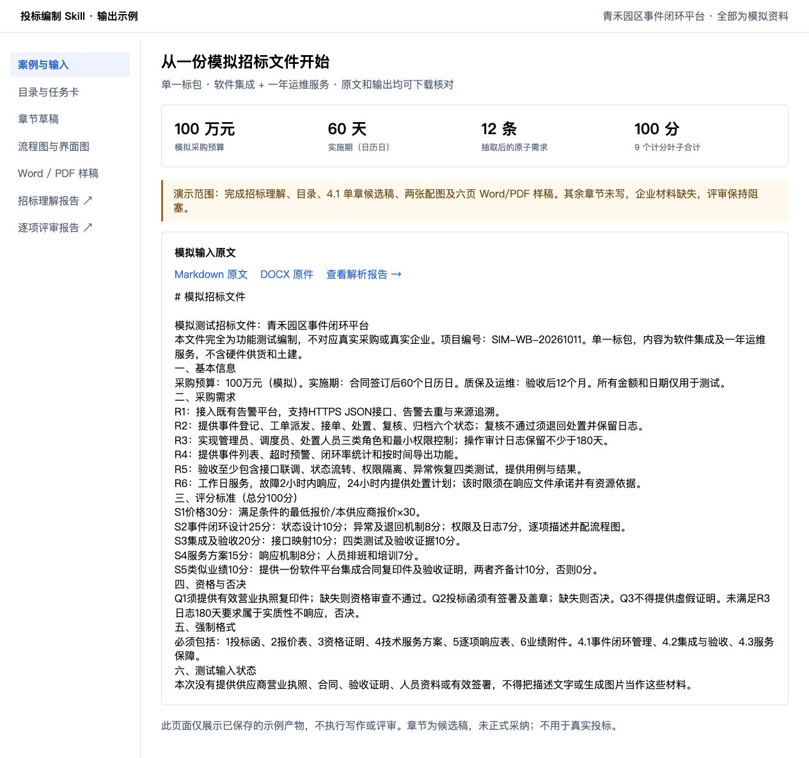
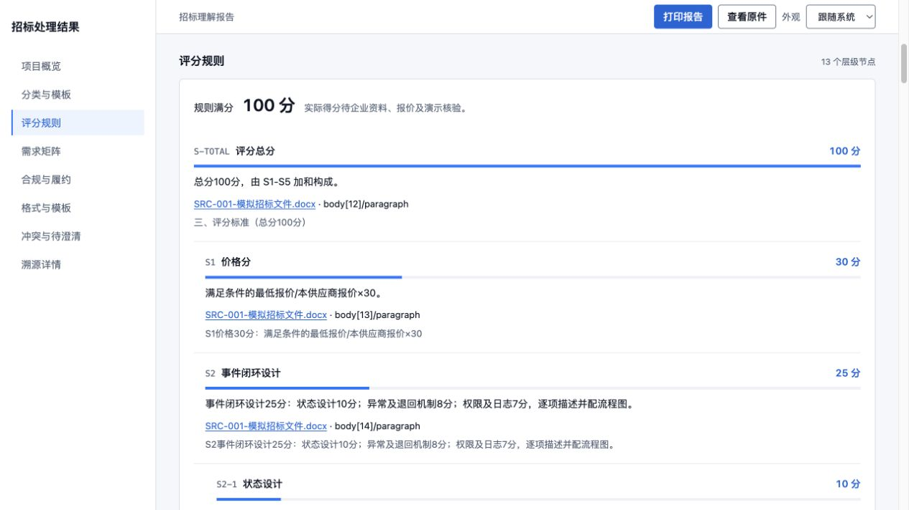
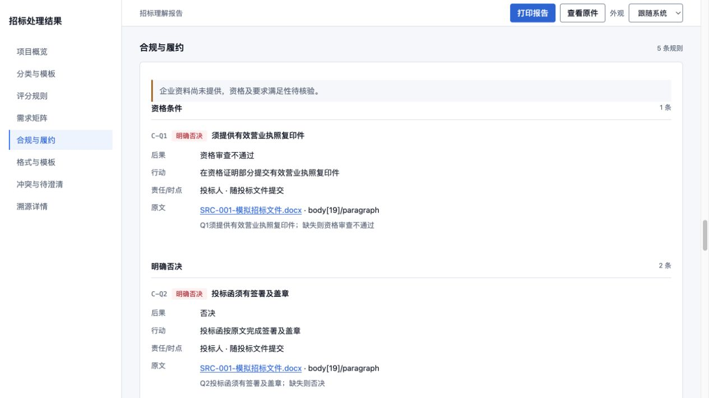
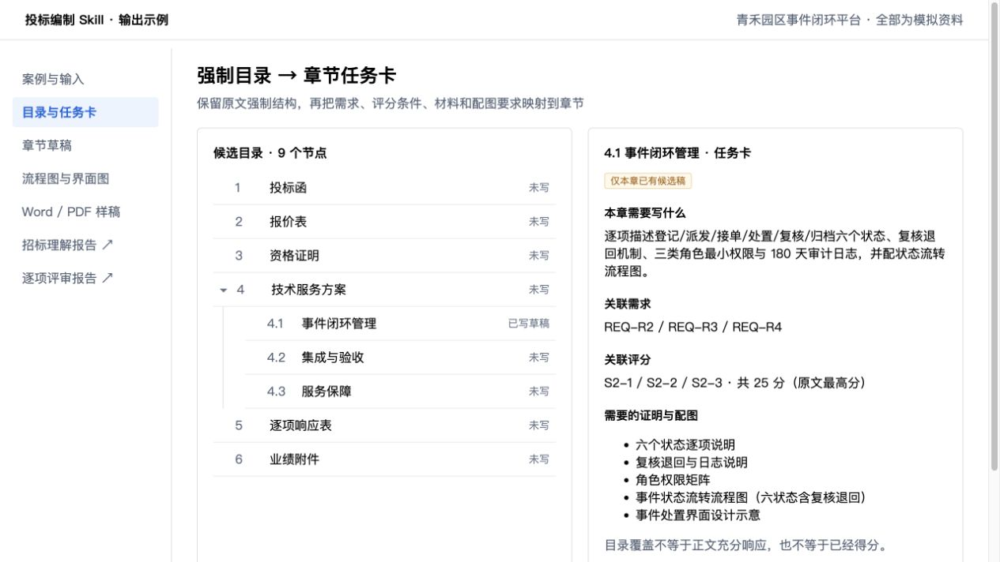
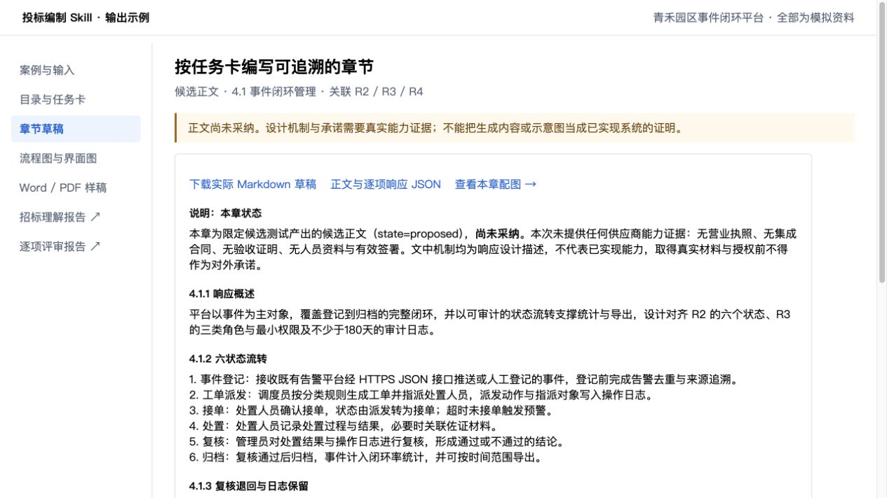
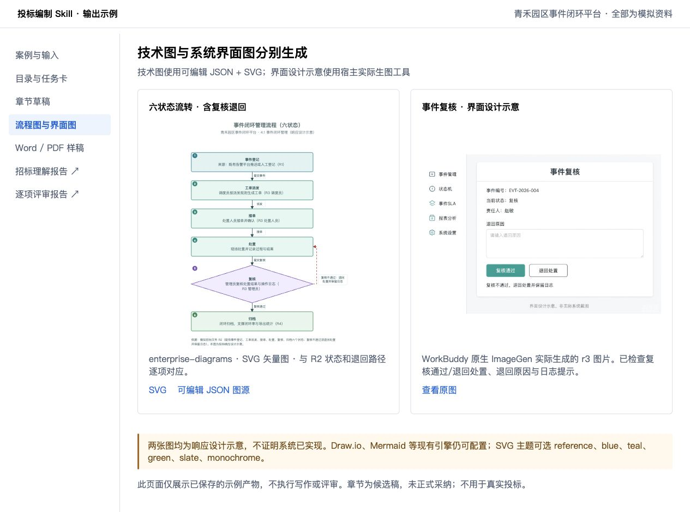
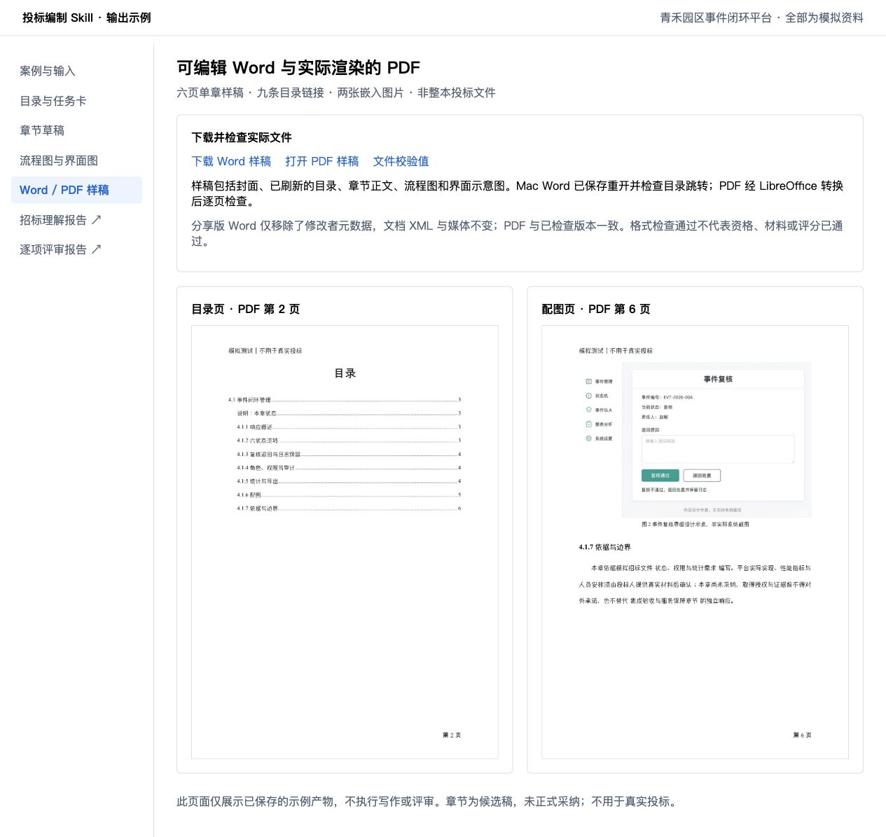

# 投标编制 Skill 套件

**版本 1.20.0 · 16 个业务 Skill + 1 个总控 Skill**

把招标文件解析、项目分类、需求与评分提取、目录、证据匹配、写作、配图、评审和 Word/PDF 导出串成一条可追溯的编标流程。安装到支持 `SKILL.md` 的宿主 Agent 后，由宿主模型和实际工具执行；不需要部署 Bid Agent 应用。

源码位于 [chrisopal/skills](https://github.com/chrisopal/skills) 的 `main` 分支。目录名 `bid-skills-suite-v1.0.0` 为兼容已有安装链接而保留，实际版本看本页与 `registry.json`。

## 先看实际效果

下面用“**青禾园区事件闭环平台**”模拟招标展示实际输出：12 条原子需求、100 分评分规则、强制目录、章节草稿、SVG 流程图、宿主生成的界面示意，以及可下载的 Word/PDF。所有采购内容均为模拟，**本例只编写 4.1 单章；缺企业材料时评审保持阻塞**。


[安装](#通用-npx-安装) · [逐步截图](#模拟案例从招标原文到-wordpdf) · [使用指令](#第一次使用) · [绘图配置](#画图skill-和渲染工具分别准备) · [模拟原文与样稿](examples/readme-demo/README.md)

## 通用 npx 安装

电脑需先有 Node.js/npm。使用开放生态的 [Skills CLI](https://github.com/vercel-labs/skills#readme) 安装完整目录，保留每个 Skill 的脚本、模板和参考文件。以下固定到本次验证的安装器版本 `1.7.2`，从本仓库 `main` 获取 Skill。

**Codex：安装 17 个投标 Skill，再安装独立绘图 Skill。**

```bash
npx --yes skills@1.7.2 add \
  'https://github.com/chrisopal/skills/tree/main/bid-skills-suite-v1.0.0/skills' \
  --skill '*' --global --agent codex --copy --yes

npx --yes skills@1.7.2 add \
  'https://github.com/chrisopal/skills/tree/main/enterprise-diagrams' \
  --global --agent codex --copy --yes

npx --yes skills@1.7.2 list --global --agent codex
```

完整安装应列出 **18 个名称：17 个 `bid-*` + `enterprise-diagrams`**。刷新宿主并新建会话，选择 `bid-orchestrator`。安装器会下载仓库，首次安装的耗时受网络影响；`--copy` 使用独立副本，同名安装会更新，已有自定义内容请先备份。

只装到当前项目时去掉 `--global`。Claude Code、Cursor 等宿主可把 `codex` 换成安装器实际支持的 Agent 名称；也可去掉 `--agent codex` 交互选择。**CLI 1.7.2 尚不接受 `--agent workbuddy`**，WorkBuddy 使用下方的完整目录复制或界面导入方式，不用 `codebuddy` 代替。

只想查看、不安装：

```bash
npx --yes skills@1.7.2 add \
  'https://github.com/chrisopal/skills/tree/main/bid-skills-suite-v1.0.0/skills' --list
```

安装 Skill 不会自动安装 Python 依赖、OCR 服务或办公软件；实际运行前看[准备运行能力](#准备运行能力)。

<details>
<summary>安装时 clone 超时、early EOF 或 partial file 怎么处理？</summary>

安装器会克隆完整仓库。本次在隔离项目实测远程安装 18 个 Skill 成功，脚本、资源和参考文件逐文件比对一致。若默认网络路径失败，Mac/Linux 可只对本次命令增加下载时限并使用 HTTP/1.1，不修改全局 Git 配置：

```bash
SKILLS_CLONE_TIMEOUT_MS=600000 \
GIT_CONFIG_COUNT=1 \
GIT_CONFIG_KEY_0=http.version \
GIT_CONFIG_VALUE_0=HTTP/1.1 \
npx --yes skills@1.7.2 add \
  'https://github.com/chrisopal/skills/tree/main/bid-skills-suite-v1.0.0/skills' \
  --skill '*' --global --agent codex --copy --yes
```

独立绘图 Skill 的下载若遇到同样问题，也可在其命令前加这四行。仍失败时按下方手动方式下载完整目录，不要只下载 `SKILL.md`。

</details>

## 手动安装与 WorkBuddy

```bash
git clone --branch main https://github.com/chrisopal/skills.git
cd skills/bid-skills-suite-v1.0.0
```

也可在 GitHub 下载 `main` 的源码 ZIP 并解压。**每个 `skills/bid-*` 文件夹才是一个 Skill**；不要把套件根目录当成单个 Skill，也不要只复制 `SKILL.md`。安装时保留该 Skill 的 `references/`、`assets/`、`scripts/` 等配套文件。

| 宿主 | 安装方式 | 安装后验证 |
|---|---|---|
| Codex 本地 | 完整复制或软链接 17 个 `bid-*` 到 `~/.codex/skills/`（自定义时为 `$CODEX_HOME/skills/`） | 新建会话，选择 `bid-orchestrator` |
| WorkBuddy 桌面端 | “专家·技能·连接器 → 技能 → 添加技能 → 上传技能”逐个导入本地包；技术用户也可复制完整目录 | “我安装的”中确认技能已启用，再新建本地任务 |
| 其他支持 Skills 的 Agent | 按宿主文档，将每个完整 Skill 目录放到其发现目录或导入单 Skill 包 | 核对名称、资源读取、脚本执行和实际输出 |
| 仅能聊天的宿主 | 提供目标 `SKILL.md` 及所需参考文件，按规程执行 | 不能据此宣称已原生安装，文件保存和导出能力需另核验 |

完整流程建议一次安装 17 个；单项使用也可以，但必须提供其必要上游结果。独立绘图 Skill [enterprise-diagrams](../enterprise-diagrams/README.md) 可作为第 18 个安装到同一发现目录，不替代 `bid-visuals`。

以上本地路径不会自动同步到云端、容器或远程 Agent。使用这些环境时，按宿主的安装方式提供完整 Skill，并让实际执行环境能读取项目目录、运行脚本及保存结果；不要把桌面端已发现当成云端已安装。

Mac/Linux 复制安装示例：从本套件根目录执行。默认目标为 Codex；安装到 WorkBuddy 时，将第一行改为 `BID_SKILL_DEST="${WORKBUDDY_CONFIG_DIR:-$HOME/.workbuddy}/skills"`。先检查所有同名目标，发现已有安装就停止，不覆盖。

```bash
BID_SKILL_DEST="${CODEX_HOME:-$HOME/.codex}/skills"
mkdir -p "$BID_SKILL_DEST"
for skill in skills/bid-* ../enterprise-diagrams; do
  target="$BID_SKILL_DEST/${skill##*/}"
  if [ -e "$target" ] || [ -L "$target" ]; then
    echo "已存在，请先核对并备份：$target" >&2
    exit 1
  fi
done
for skill in skills/bid-* ../enterprise-diagrams; do
  cp -R "$skill" "$BID_SKILL_DEST/${skill##*/}"
done
```

Windows 可用文件管理器复制完整目录，或用 PowerShell：从本套件根目录执行，先将 `$bidSkillDest` 改成实际宿主目录。WorkBuddy 默认示例为 `$env:USERPROFILE\.workbuddy\skills`；自定义配置目录时以实际位置为准。

```powershell
$bidSkillDest = Join-Path $env:USERPROFILE '.workbuddy/skills'
$bidSources = @(Get-ChildItem './skills/bid-*' -Directory) + @(Get-Item '../enterprise-diagrams')
New-Item -ItemType Directory -Force $bidSkillDest | Out-Null
foreach ($item in $bidSources) {
    if (Test-Path (Join-Path $bidSkillDest $item.Name)) { throw "已存在：$($item.Name)，请先备份" }
}
foreach ($item in $bidSources) { Copy-Item $item.FullName (Join-Path $bidSkillDest $item.Name) -Recurse }
```

需要上传包时，先在本套件目录运行：

```bash
python scripts/refresh_distribution.py
python scripts/check_suite.py
```

这会在本地生成 `installable-zips/` 下 17 个单 Skill ZIP。ZIP 是生成物，**GitHub 源码中不预置这些包**；刷新分发需要保留同一仓库相邻的 `enterprise-diagrams/`。独立绘图 Skill 的打包方法见其 [README](../enterprise-diagrams/README.md)。更详细的安装与更新步骤见 [先读我](START_HERE_先读我.md)。

## 准备运行能力

Skill 不附带模型、API Key、OCR 服务或办公软件。阅读规程不要求 Python；运行辅助脚本需要 **Python 3.10+**，建议在套件目录创建虚拟环境：

```bash
python3 -m venv .venv
.venv/bin/python -m pip install -r requirements.txt
.venv/bin/python scripts/check_suite.py
```

Windows 对应解释器为 `.venv\Scripts\python.exe`。告诉宿主使用该解释器的绝对路径；安装依赖并不保证宿主默认 `python` 指向它。仅结构校验可安装 `requirements-core.txt`；`requirements.txt` 另含 DOCX/PDF 原生处理依赖。

| 能力 | 额外准备 | 不可用时 |
|---|---|---|
| 原生 DOCX/PDF 解析 | `python-docx`、PyMuPDF，已列入 `requirements.txt` | 保留未读范围；不能声称完整解析 |
| 扫描件 OCR | 显式配置已部署的 PaddleOCR 服务，Key 只放环境 | 记录待补读页，见 [OCR 配置](docs/OCR_SETUP.md) |
| 企业知识 | 本地资料或宿主实际开放的知识检索工具 | 记录资料缺口；见 [知识接入](docs/KNOWLEDGE.md) |
| 技术图 | 下节列出的引擎 | 显式引擎缺失时保持 blocked |
| 系统界面示意 | 宿主原生生图 Skill/工具及授权 | 缺图保持整改项，不拿提示词当图片 |
| Word/PDF 与目录刷新 | 宿主文档工具，或本地 LibreOffice/Word | 只交付已验证的格式；目录域未刷新单列未完成 |
| 分章并行 | 宿主实际支持子 Agent | 记录串行执行及原因，不伪造并行记录 |

## 模拟案例：从招标原文到 Word/PDF

以下均为实际保存的模拟案例产物或其文档展示页的浏览器截图，未把未执行的阶段画成完成状态。示例截图采用本套件的企业报告风格；这不是需要部署的标书 Web 应用。

### 1. 输入：一份软件集成与服务组合的模拟招标文件

预算 100 万元，实施期 60 个日历日，一年运维；原文列出六状态事件闭环、三类角色、180 天审计日志及评分条件。可下载 [Markdown 原文](examples/readme-demo/inputs/tender.md) 或 [DOCX 原件](examples/readme-demo/inputs/SRC-001-模拟招标文件.docx)。



### 2. 分类：识别标包，匹配模板

识别为单一标包，匹配“软件开发与系统集成 + 服务与外包”。预算、期限、采购范围有据可查；原文没提供的采购人、截止时间等不补造。类别与标包范围进入响应前需要确认。


### 3. 解析：需求、评分、否决与格式分别保存

需求矩阵保留原文、条件、验收依据和位置。本例从原文中提取 **12 条原子需求**；评分保留 **13 个层级节点、9 个计分叶子，合计 100 分**，规则满分与实际得分分开。


<details>
<summary>评分规则、资格否决与强制格式的实际截图</summary>

**评分规则**：价格公式、各项分值、正文和证明材料要求分别记录。



**资格与否决**：营业执照、签署盖章、日志保留期等要求保留后果、行动和原文依据。



**强制格式**：保留招标要求的六部分结构和技术服务方案的三个子章节，避免套用通用目录覆盖原文。


</details>

### 4. 规划：目录节点带有写作任务卡

每个章节映射需求、评分、材料与配图。本例的 **4.1 事件闭环管理**关联三个评分叶子，原文最高分共 25 分；其他章节仍显示“未写”，目录覆盖不代表内容已完成。



### 5. 写作：先输出可修改、可追溯的候选稿

本章逐项展开六状态、复核退回、权限和审计机制。用户可在宿主对话中调整目录、篇幅、内容和配图，再由总控更新当前版本。下载 [Markdown 草稿](examples/readme-demo/artifacts/11-chapter-4.1.md)；篇幅、评分驱动详写和界面图数量见[章节写作配置](docs/CHAPTER_WRITING_POLICY.md)。



### 6. 配图：可编辑技术图 + 宿主生成的界面示意

左侧为 `enterprise-diagrams` 输出的 SVG 六状态流程，含复核不通过退回处置；右侧为 **WorkBuddy 原生 ImageGen 实际生成**的事件复核界面。Codex 中由其实际可用的 ImageGen 工具生成，工具选择由 Skill 驱动。界面图明确标注为设计示意。



[查看 SVG 原图](examples/readme-demo/assets/fig-4.1-event-flow.svg) · [可编辑 JSON 图源](examples/readme-demo/assets/fig-4.1-event-flow.diagram.json) · [查看界面图原图](examples/readme-demo/assets/fig-4.1-ui.r3.png) · [独立绘图 Skill 与 8 类图布局](../enterprise-diagrams/README.md)

### 7. 评审：逐项检查评分、关键材料与资格否决

实际报告给出 **17 项逐项结论、9 项未关闭问题、4 项阻塞问题**。本例没有营业执照、签署及业绩证明，因此保持“暂不能建议正式交付”；排版修好、图片生成成功不会把缺材料变成通过。问题中保留整改建议，宿主可继续执行修复、重写或提升，再重新评审。


### 8. 导出：打开实际 Word/PDF 检查结构

本例交付 **六页单章样稿**，包括封面、目录、正文和两张配图。目录的九条链接已检查，Word 已保存重开，PDF 已逐页检查。可直接下载 [可编辑 Word](examples/readme-demo/deliverables/chapter-4.1-sample.docx) 和 [PDF](examples/readme-demo/deliverables/chapter-4.1-sample.pdf)；封面、目录和排版配置见[导出配置](docs/EXPORT_LAYOUT.md)。



这是用于理解输出形式的**限定范围演示**，不是整本标书验收或真实投标材料。[示例目录](examples/readme-demo/README.md)包含原文、JSON 产物、HTML 报告、图源和样稿，可离线打开检查。

## 在线文档协作（飞书）

1.20.0 增加 **写作设置 → 在线协作**：指定飞书文档链接，选择已授权用户或明确选择的应用身份，绑定后按章读取、保存和回读。团队按章节分工，接手者先拉取当前在线稿；成员授权、同时编辑和历史由飞书负责。招标原件和企业证据仍需对应的项目材料访问权。

当前复用已安装的 `lark-cli`，不新增模型服务；安装投标 Skill 不会自动完成飞书授权。正文与图片权限分别核验。当前 CLI 未提供已验证的原子条件覆盖，因此已有章节改写需在飞书原生编辑器合并后拉回；自动同步可新增章节并确认未变章节。部分写入、人工更改、未知资源或锚定评论会停止覆盖，保留本地候选。腾讯文档和 Office 仅保留扩展接口。

[接入、命令、接力与审核边界](docs/ONLINE_DOCUMENTS.md)。AI 限定评分只使用已同步章节，整本审核仍要求完整同步，并保留关键材料和否决条件门禁。

可直接向宿主说：

> 请调用 bid-orchestrator，将当前项目绑定到【飞书文档链接】，使用我已授权的身份。按目录任务分章，新增章写入后回读正文和配图；接手已有章时先拉取，在飞书合并修订，保留原文和评分映射。完成后审核并模拟评分，列出未同步、缺材料与未评范围。

本轮[实际验证记录](../docs/plans/2026-10-16-online-bid-documents-validation.md)：东台章节写入、接力拉回、评论和限定评分已实测；青草沙在用户重新授权后完成正文与三图上传、下载哈希核对及拉回。应用身份首次权限失败保留为反例；真人双账号协作及完整 Word/PDF 尚未验收。

## 第一次使用

先建一个**独立项目目录**并作为宿主工作空间。把招标原件和补遗放到 `inputs/`，企业方案、证照等作为明确授权的资料输入。原件只读，不把项目结果写回 Skill 安装目录。

第一条指令可直接复制，替换项目路径：

> 请调用 bid-orchestrator，项目目录为【项目绝对路径】。先按 understand 模式读取 inputs 中的招标文件和补遗，识别标包、采购类型及组合模板，提取基础信息、需求、评分、资格否决与强制格式。保存带原文位置和输入哈希的 JSON/Markdown，并生成 HTML 报告。缺页、缺附件或分类歧义保留待确认。先不要编写整本标书。

理解无误后继续：

> 基于当前理解结果，继续响应策略、目录和证据匹配，生成章节任务卡。只使用已提供的企业资料，资质、业绩、人员、报价缺失时保留缺口。给出需要确认的方案和关键承诺。技术图使用 blueprint、teal 主题、SVG 输出；系统界面示意使用本宿主实际生图 Skill。

确认方案后写作：

> 按已确认目录编写所有章节。评分重点自动推荐篇幅，章节【稳定ID】覆盖为2000字、至少1张界面示意。若宿主支持子 Agent，按任务卡独立写章，由一个协调者合并；否则串行。实际保存并回读，保留未满足项。

评审与导出：

> 调用 bid-review-remediation 审核当前版本的评分条件、关键材料完整性和资格/否决条件。可修复的内容定向整改并复评，缺证照或签署不能靠改写通过。再调用 bid-export-acceptance，按招标强制格式及项目导出配置生成实际Word/PDF，核对目录、页码、附件、图表及真实渲染页面。不要代签、盖章或递交。

对话可随时调整目录、章节、篇幅和配图；宿主须保存新修订并使受影响评审/导出重新核验。网页上的“修复/重写/提升”生成版本绑定的任务；没有宿主唤醒接口时须把交接指令送回宿主执行，不能把按钮点击当作已修复。

### AI 模拟专家评分

1.18.0 起，15 支持对已写标书按招标原文模拟专家打分。当前宿主模型实际阅读正文与证明材料，逐项输出**模拟分、评分档次与区间、扣分理由、证据定位和提升动作**。无需新增模型 API；只运行 Python 脚本会生成未评计划，不会自动得到 AI 分数。

> 调用 bid-review-remediation 对当前完整标书做 AI 模拟专家评分。逐项回读招标评分原文、实际章节和证明材料，严格按原文档次和封顶计分，给出扣分理由及提升建议，保存 JSON 和 HTML。价格分缺必要输入保持未知；无法核验的现场演示和材料不要猜分。

看完报告后，可以继续要求“优先提升高分值失分章节，保存新稿并重新评分，保留前后版本”。单独请求评分时只生成评读结果与建议。

1.19.0 起，写作工作台的**写作设置 → AI 模拟评分**可以直接发起当前版本评分、查看报告、刷新结果，勾选扣分项后创建提升任务。页面显示已评小计、待核验及未评上限；未保存正文或设置时先保存，修改后的旧报告会标为过期。提升只处理选中范围内可改写的正文，证照、价格和无法核验的事实保留补料提示。

当前本地工作台通过**宿主交接**执行：按钮保存任务后显示“待宿主执行”，将交接指令复制到当前 Agent，由宿主读取原文和现稿实际评分或修改，完成后刷新结果。没有宿主唤醒接口时不会自动在后台运行模型；创建任务不表示已经评分或提升。

结果保存为 `reviews/15-ai-scoring-rN.json` 和 `reports/ai-scoring-rN.html`。只评部分章节时显示已评小计与未评上限，不折算为整本满分；模拟分不解除资格、废标和缺材料门禁，也不保证官方得分或中标。规则、现稿或材料变化后重新评分。流程、命令与边界见 [AI 模拟专家评分](docs/AI_EXPERT_SCORING.md)。

## 画图：Skill 和渲染工具分别准备

`bid-visuals` 管理图的用途、章节关联、来源与审核；独立 `enterprise-diagrams` 提供可复用版式。配置写入项目 `work/writing-settings.json` 的 `visuals`，不要只在聊天里说“已配置”。建议让总控读取已有设置再保存；不要用片段覆盖整份文件。

| 选择 | 适用图 | 安装/依赖与输出 |
|---|---|---|
| `blueprint` + enterprise-diagrams | 分层架构、流程、泳道、网络、并行、简单时序、矩阵 | Python 标准库生成 SVG；保留 `.diagram.json`。8 类布局、6 套主题；PNG 另需宿主已有 CairoSVG |
| `drawio` | 复杂架构、部署、网络和需图形编辑的流程 | 保留现有 Draw.io 路径；需实际 Draw.io Desktop/CLI。原生 `.drawio` + SVG/PNG；加载 Skill 不等于安装桌面渲染器 |
| `plantuml` | 时序、异常分支与较复杂交互 | 实际 PlantUML 命令，或 Java + `PLANTUML_JAR`；保留 `.puml` |
| `mermaid` | 简单流程 | 已有 Mermaid CLI 与可用浏览器；保留 `.mmd` |
| 宿主生图 | 系统界面示意、概念效果图 | Codex 使用实际 Imagegen；WorkBuddy 使用本次开放的生图能力，不复制 Codex 的工具名冒充兼容 |

主题：`reference`、`blue`、`teal`、`green`、`slate`、`monochrome`。例如“这张架构图改用 blueprint、blue 主题、四层、SVG”；层数服从实际设计，不为模板发明组件。未显式选择时 `auto` 按图型及已安装工具路由，默认 SVG，保留 Draw.io。配置优先级为逐图指令 → 项目偏好 → 默认规则。

先运行 `python scripts/diagram_tools.py doctor` 检查工具发现，再实际渲染。安装包、命令、原生源与渲染收据说明见 [技术图工具](docs/DIAGRAM_TOOLS.md)。独立 Skill 安装后可直接说：

> 调用 enterprise-diagrams，把以下已确认组件和关系画成四层架构，主题teal，保存可编辑JSON源和SVG，检查文字、连线与A4可读性。

系统界面生成图须标 **“界面设计示意，非实际系统截图”**。真实截图必须来自实际系统；两者不能互作证明。图必须实际生成、插入正文并在导出中核验，工具退出码不代替视觉与语义验收。

## 项目如何保存与续写

```text
项目目录/
├── inputs/        原件与补遗（只读）
├── profiles/      分类、导出等显式项目配置
├── work/          project.json、总控状态、写作设置和任务记录
├── artifacts/     01—14结构化结果及可读报告
├── assets/        图源、成图与调用收据
├── reviews/       15评审、缺口与整改结果
├── deliverables/  16实际交付文件与清单
└── reports/       同版本HTML展示
```

跨 Skill 通过项目文件、稳定 ID、修订号和实际输入哈希交接，不依赖聊天记忆。更换 Agent 后提供同一项目目录并要求读状态再继续；本地文件需显式迁移到另一个设备。宿主知识库结果需导入项目快照/Wiki；安装 Skill 不会自动同步不同宿主的知识库、密钥和模型。

## 技能目录

| 编号 | 技能 | 标识 |
|---|---|---|
| 01 | 招标资料整理与原文解析 | `bid-source-intake` |
| 02 | 项目画像与场景适配 | `bid-project-profile` |
| 03 | 需求提取与结构化 | `bid-requirements` |
| 04 | 评分体系提取与分析 | `bid-scoring` |
| 05 | 资格、否决条件与提交要求提取 | `bid-compliance` |
| 06 | 强制目录与格式模板提取 | `bid-format-extraction` |
| 07 | 需求澄清与投标响应策划 | `bid-response-strategy` |
| 08 | 标书目录规划与覆盖映射 | `bid-outline-planning` |
| 09 | 企业素材与证明材料匹配 | `bid-evidence-matching` |
| 10 | 技术方案设计 | `bid-solution-design` |
| 11 | 技术标正文与响应表编写 | `bid-technical-writing` |
| 12 | 商务与资格文件编制 | `bid-commercial-documents` |
| 13 | 标书配图与图表制作 | `bid-visuals` |
| 14 | 标书排版与文档编排 | `bid-document-layout` |
| 15 | 综合评审与整改闭环 | `bid-review-remediation` |
| 16 | 导出与成稿验收 | `bid-export-acceptance` |
| 17 | 投标编制总控 | `bid-orchestrator` |

## 配置与进阶说明

- 分类：四类采购内容（工程、硬件供货、软件集成、服务外包）可组合，智慧园区/智能工厂是场景标签；见 [分类与模板](docs/TENDER_ROUTING.md)。
- 写作：[目录、编辑与保存](docs/WRITING_WORKFLOW.md)、[评分篇幅与界面图策略](docs/CHAPTER_WRITING_POLICY.md)、[实际子 Agent 并行](docs/PARALLEL_WRITING.md)。
- 成稿：[版式模板](docs/BID_LAYOUT_TEMPLATES.md)、[封面/目录/字体/缩进/行距配置](docs/EXPORT_LAYOUT.md)。招标文件和有效补遗优先于通用模板。
- 质量：[核心逐项评审](docs/CORE_REVIEW.md)、[AI模拟专家评分](docs/AI_EXPERT_SCORING.md)、[质量闭环](docs/QUALITY_WORKFLOW.md)、[修复/重写/提升](docs/REVIEW_ACTIONS.md)、[评审展示](docs/REVIEW_PRESENTATION.md)。
- 报告：[HTML展示](docs/REPORTS.md)、[执行复核](docs/EXECUTION_QUALITY.md)、[已知问题](docs/KNOWN_ISSUES.md)。
- 测试：[工程记录](QA_REPORT.md)、[WorkBuddy实测](docs/WORKBUDDY.md)、[模拟材料闭环](docs/SIMULATION_TESTING.md)、[公开招标语料](benchmarks/public-tenders/README.md)。

## 更新与验证边界

源码副本用 `git pull --ff-only` 更新；复制安装需先把同名旧 Skill 备份到宿主发现目录**以外**，再安装完整新目录。软链接安装保留源码路径，新会话核对实际加载版本。不要删除其他 Skill 或把旧、新目录同时留在发现目录造成重复加载。现有项目不因更新自动重跑，继续前核对版本及受影响产物。

工程检查可在已安装依赖的环境运行 `python scripts/check_suite.py` 和 `python -m unittest discover -s tests -v`。需要完整 pytest 回归时另使用已有 pytest 环境。结构、分发一致性、模型执行、视觉检查和真实业务验收是不同证据。DOCX 原生解析与核心评审现在可按段落／单元格精确核验引文；复杂页眉歧义、扫描及渲染范围仍保留限制，见 [WorkBuddy实测边界](docs/WORKBUDDY.md#docx-来源核验与边界)。

本套件不附真实客户原件、证照或法定行业结论，不代签、不递交。种子模板和合成材料用于验证；模拟评审通过不能替代真实材料与授权。宿主/模型/工具组合的实际覆盖以测试记录为准，不承诺所有平台自动兼容。
